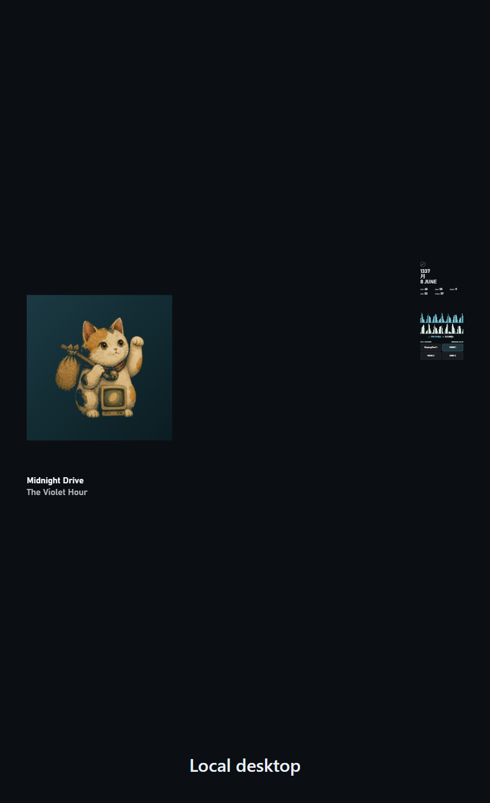

#  widgetsack

<p align="center">
  
</p>

[**Download the latest installer**](https://github.com/gyng/widgetsack/releases/latest)

A desktop widget overlay for Windows. Your meters, your layout, your little control room.

Show system meters, clocks, and music on a transparent overlay across your monitors.
Arrange widgets in the built-in visual editor, **Studio**. Use CSS and design tokens
to change their appearance. Connect Home Assistant, MQTT, or stock quotes for more live data.

A sensor supplies a value. A widget shows it. The overlay lets clicks pass to the desktop,
while widget buttons and controls remain available.

## Widget gallery

[**Widget reference**](docs/widgets.md) · [**Templates and formulas**](docs/templating.md) · [**Themes**](docs/theming.md)

To update the screenshots and reference docs, run `npm run gen:gallery` in `client/`.
To update only the reference docs, run `npm run gen:docs`.

## Dashboard presets

Start with one of four bundled dashboards. Keep it as supplied, or make it yours.

| Work | Gaming |
| --- | --- |
|  |  |
| Agenda, tasks, focus timer, and alerts. | Performance history, GPU stats, latency, and music. |

| Home | Minimal |
| --- | --- |
|  |  |
| Weather, upcoming events, service health, and household tasks. | Time, download speed, CPU history, and alerts when needed. |

1. Open **Share** in Studio.
2. Select **Built-in: Work**, **Built-in: Gaming**, **Built-in: Home**, or **Built-in: Minimal** to import it.
3. Open **Layout → Add → My widgets**. Insert the dashboard.
4. Configure its widgets in the inspector. Select **Save** to save the layout.

Configure Weather and Agenda in their plugin settings. For the Home Assistant health card,
enter the URL of the endpoint to check.

The screenshots use sample data. New task lists are empty. Alerts appear when a rule triggers.
To update these images, run `npm run gen:presets` in `client/`.

### Local desktop layout

| Local desktop |
| --- |
|  |

Load **Built-in: Local desktop** from **Presets** to use this complete monitor layout.
It includes clocks, media, network charts, and CPU charts. The CPU charts find the cores on your machine.
The monitor switcher uses the primary display and finds its available inputs.
You can also insert **Local desktop** from the widget list or import its sack from **Share**.

### Smooth charts

1. Open **Layout**.
2. Select an existing **System monitor** or **Network** group.
3. Enable **Smooth charts** in the Inspector.

For a separate **CPU**, **Sparkline**, or **Sensor History** widget, open **Appearance** in the Inspector.
Enable **Smooth charts**. System monitor and Network also have this option when you insert them.
CPU smoothing applies to the per-core chart view.
Smoothing changes the display. Recorded sensor values stay unchanged.

## Layout studio

<p align="center">
  
</p>

## Features

- **Widgets:** show gauges, bars, graphs, text, clocks, calendars, system meters, weather, and stock
  quotes. Add alerts, checklists, sensor history, service health, or an audio mixer. Control media,
  audio outputs, monitor inputs, and Home Assistant devices. See the [widget reference](docs/widgets.md)
  for the full list. Use sensors or [formulas](docs/templating.md) to supply values.
- **Sensors:** read CPU load and frequency, memory, swap, network traffic, disk use and I/O, uptime,
  battery, and process activity. Read NVIDIA GPU data through NVML. Cheap baseline sensors keep their normal refresh rate.
  Expensive sensors run when a widget or visible sensor row needs them. Recycle Bin values refresh at most every ten seconds.
- **Charts:** enable **Smooth charts** in the Inspector to blend changes between readings.
  Use it on CPU, Sparkline, Sensor History, or grouped charts. Recorded values stay unchanged.
- **Timer:** choose **dial** style for a kitchen timer with a raised knob. Drag to set up to 60 minutes;
  release to start. Use a box around 220 × 280 for a comfortable grip. Digital style also supports a stopwatch.
- **Now playing:** show Windows media through GSMTC. Sources include Spotify, foobar2000, and browsers
  ([support table](https://github.com/ModernFlyouts-Community/ModernFlyouts/blob/main/docs/GSMTC-Support-And-Popular-Apps.md)).
- **Integrations:** connect Home Assistant, MQTT, stock quotes, and Open-Meteo weather.
  Open-Meteo needs no API key. Home Assistant tiles show device states and control lights,
  climate, fans, covers, locks, scenes, switches, and media.
- **Overlay:** use one transparent overlay per monitor. Keep it below windows, always on top,
  or behind desktop icons. Widget controls can receive clicks. Run one app instance and optionally start it at login.
- **Studio:** drag, resize, and snap widgets. Browse sensors, build reusable widgets, edit themes,
  and save layouts. Share widget bundles, called **sacks**. Layouts reload when `widgets.json` changes.
- **Templates:** insert starter groups for clocks, system meters, network traffic, and music.
  Some recreate classic Rainmeter skins.
- **Macros:** make a button run a sequence of actions, such as Home Assistant calls or media commands.
- **Plugin packages:** install community templates, themes, and sensor sources. Enable each package
  when you choose. See the [authoring guide](docs/third-party-plugins.md).
- **Themes:** edit each widget's CSS with syntax highlighting and lint checks. Use design tokens
  and system fonts. Apply one theme to all monitors, or choose a theme for each monitor.
- **Window zones:** define snap regions for app windows, including Electron and UWP apps.
  Drag windows into a region, or arrange them with rules.
- **Side monitors:** use the extra space on displays such as the Corsair Xeneon Edge, Lamptron, or Turzx.

Built with Tauri and React.

## Coming from Rainmeter?

The meters, clocks, and music cards will feel familiar. The editor and layout use web technology.

- **Memory use:** each monitor has a browser-based overlay. Allow about 100 MB of RAM and 40 MB
  of VRAM per monitor with active widgets. Actual use depends on the layout and hardware.
- **Sensor and meter:** connect sensors in Studio. Layouts use CSS flexbox.
  Each widget can have its own CSS and design tokens.
- **Templates:** insert a bundled skin layout, or build reusable widgets in the widget designer.
- **Data sources:** combine local system data with Home Assistant, MQTT, and stock quotes.
- **Layout containers:** arrange widgets in grids, rows, or columns. Use floating widgets for free placement.

## Usage

Download the installer from the [latest release](https://github.com/gyng/widgetsack/releases/latest).

The overlay starts in passive mode. Clicks pass through it to the desktop. To arrange widgets:

1. **Open the studio.** Left-click the tray icon, use the Start menu shortcut, or select
   **Open studio** in the tray menu.
2. **Arrange widgets.** Open **Layout**. Select **Add** to insert a widget. Drag it to move it.
   Drag its handles to resize it. Use the inspector to change its sensor, position, or settings.
3. **Save the layout.** Layout data is stored in `widgets.json` in the app configuration directory.
   Changes to this file reload automatically. Use **Presets** to save and restore a monitor's arrangement.

To edit directly on the desktop, press **`Ctrl+Alt+E`**. Press it again to return to passive mode.
Inside a widgetsack window, use **`Ctrl+E`**.

If the overlay stops responding, press **`Ctrl+Alt+Shift+E`**. This rescue shortcut brings every
widgetsack window forward and lets it receive clicks, even after a webview crash.
**Settings → Diagnostics** has the same control, live logs, and **Copy diagnostics** for bug reports.

### Studio AI assistant

Select **Assistant** in Studio toolbar to open the chat sidebar. Ask it to add widgets,
change their settings, arrange them, or edit their CSS. Changes appear on the desktop and can be
undone. Select **Save** to keep them.

The assistant prefers installed agents: Pi first, then Codex, then Claude. It uses their existing
login and settings. You can select any installed agent in the sidebar.

The native adapter launches agents from your environment. It ships no Node runtime or
`node_modules`, and downloads nothing. If no agent is found, install and sign in with
[Pi](https://pi.dev/), Codex, or Claude, then select **Refresh agents**. Pi uses the Node runtime
from its own installation; standalone Codex and Claude executables do not require Node.
Use these controls in the sidebar:

- **Model:** leave it blank to use the agent default. Select a suggestion or enter a model ID.
- **Stop:** cancel the current request.
- **New chat:** clear the conversation.

The assistant has its own sidebar across Studio. Your widget list and Inspector stay available.
Upgrades remove the old bundled agent files, including `node_modules`.

### Your agent, your choice

Connect your own agent through **Settings → MCP**. The connection uses the Widgetsack executable.
Node is not required. You can keep the assistant sidebar closed.

- Read and edit layouts.
- Check widget sizes and clipping.
- Take a Studio screenshot to review the result.
- Enable browser access if your agent needs DOM inspection or browser controls.

See [MCP setup and tools](docs/mcp.md).

### Theming

Add CSS to a widget to change its appearance. For example, this rule makes its images grayscale:

```css
img {
  filter: grayscale(1);
}
```

### Now playing: source priority

If several media sources are active, set their priority in edit mode. The list uses executable names.
The widget shows the source with the highest priority. **All media** lists the current sources.

### Launch at login

Enable **Launch at login** in **Settings → Startup**, in the tray menu, or on the installer's final page.

To enable automatic update checks, open **Settings → About**. These checks are off by default.
To download or install an update, open the release page.

## Plugins

Manage both plugin types in Studio's **Plugins** section:

- **Built-in integrations:** configure Home Assistant, MQTT, stock quotes, and the AI provider.
  Tokens and API keys stay in the Rust backend. The webview does not hold them.
- **Third-party packages:** add community templates, themes, or sensor sources.
  Templates are widget groups with options you set when you insert them. A sensor source uses
  `source.js` to request API data. Bind its `pkg.<id>.*` sensors to meters or formulas.

To install a package, copy its folder to `plugins/` in the app configuration directory.
You can also use **Plugins → Packages → Install a package**. Enter `owner/repo`, a GitHub link,
or an HTTPS URL for `plugin.json`. Select **Install**.

To check for a package update, select its **Check updates** control. Package update checks are manual.

You control which packages can run:

- **Installation:** packages start disabled. Enable each package on each machine.
  A reinstalled package needs approval again.
- **Code:** templates and themes contain data. Packages cannot add their own components.
  Only `source.js` can run code. It runs in a QuickJS WebAssembly sandbox with no direct network,
  DOM, or Tauri access. Each tick has a CPU time limit of about 100 ms.
- **Network:** the Rust backend makes requests to approved HTTPS hostnames from the package manifest.
  Approve these names when you first enable the package. Approve them again if an update changes the list.
- **Theme CSS:** the app scans for remote `url()` and `@import` references, and overlays that cover
  the viewport. A flagged theme needs confirmation. Enable packages only from sources you trust.

To make a package, read the [authoring guide](docs/third-party-plugins.md).
The [sample pack](examples/packages/sample-pack) includes a clock template with options,
an [Open-Meteo](https://open-meteo.com) weather source, and a small theme.
CI tests the sample against the package pipeline on each build.

## Development

For build commands, required checks, and release steps, read [Development](docs/development.md).

For typography, spacing, and alignment rules, read the [design system](docs/design-system.md).
For the architecture and roadmap, read [Widget platform](docs/widget-platform.md).

## License

Licensed under either of

- Apache License, Version 2.0 ([LICENSE-APACHE](LICENSE-APACHE) or
  <http://www.apache.org/licenses/LICENSE-2.0>)
- MIT license ([LICENSE-MIT](LICENSE-MIT) or <http://opensource.org/licenses/MIT>)

at your option.

Unless you explicitly state otherwise, any contribution intentionally submitted
for inclusion in the work by you, as defined in the Apache-2.0 license, shall be
dual licensed as above, without any additional terms or conditions.

<p align="center">
  
</p>
