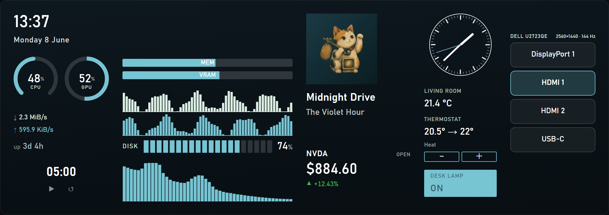
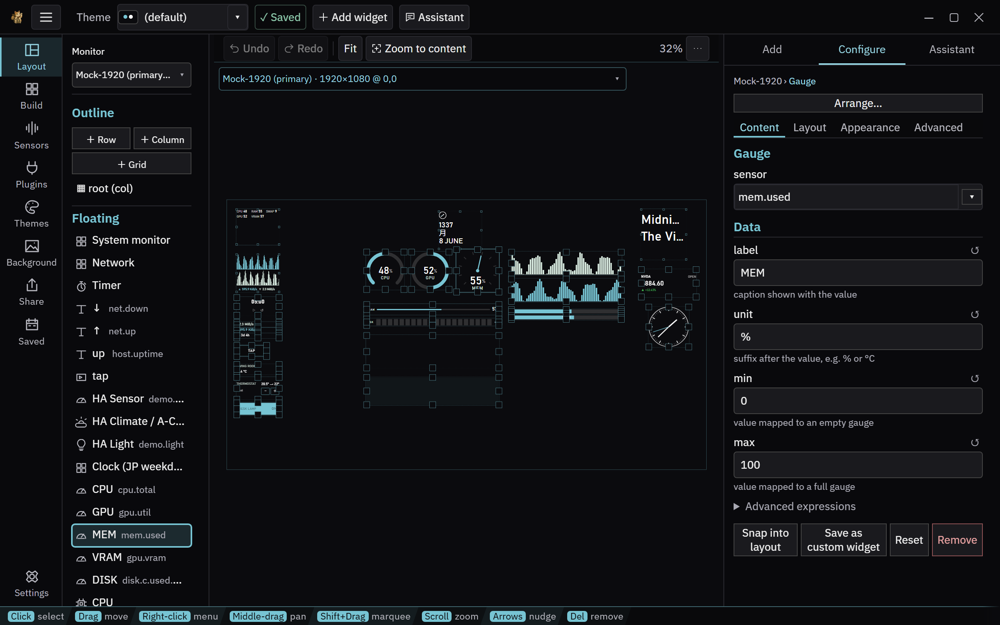
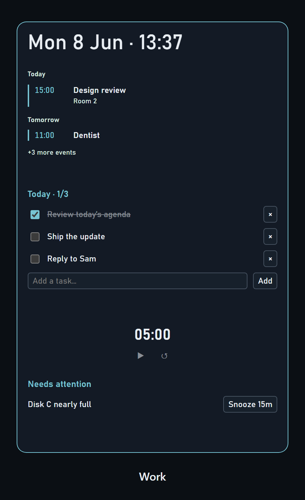
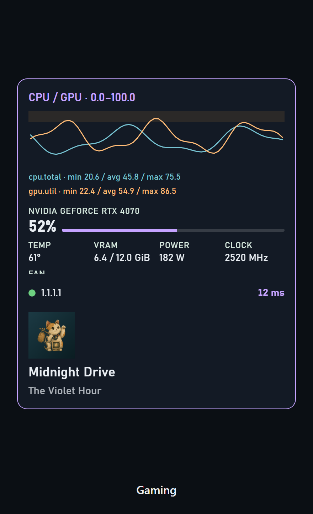
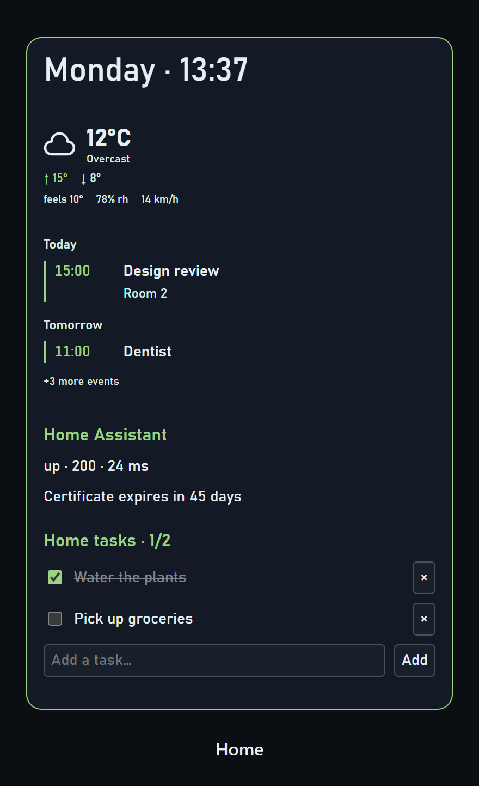
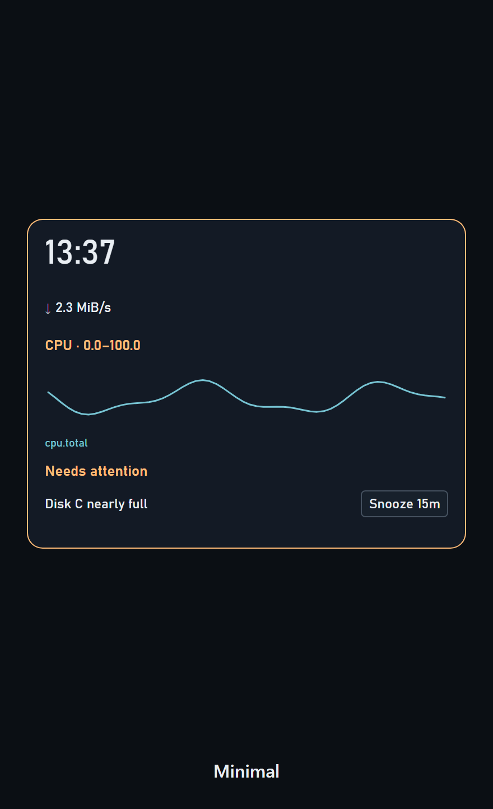

#  widgetsack

  

[**Download the latest installer**](https://github.com/gyng/widgetsack/releases/latest)

Widgetsack displays desktop widgets on transparent overlays across Windows monitors.
Widgets show system measurements, clocks, media information, and data from Home Assistant,
MQTT, and stock services.

Use Studio to arrange widgets and configure their data sources. CSS and design tokens
control their appearance. Clicks pass through the overlay to the desktop, except on widget
buttons and controls.

## Features

- **System monitoring:** CPU load and frequency, memory, GPU, disks, network traffic, battery, and process activity.
- **Widgets:** clocks, calendars, weather, media information, timers, task lists, alerts, and stock quotes.
- **Controls:** media playback, volume, audio outputs, monitor inputs, and Home Assistant devices.
- **Layouts:** arrange widgets in rows, columns, grids, or free positions. Each monitor has its own layout.
- **Themes:** change fonts, colors, and spacing. Apply one theme to all monitors or select a theme for each monitor.
- **Agent-assisted design:** ask your agent to build and refine widgets from the built-in meters, live sensors, and CSS.
- **Window zones:** define regions where you can place app windows.

GPU readings currently support NVIDIA GPUs. Media controls work with apps that support Windows media sessions.

See the [widget reference](docs/widgets.md) for the full list of widgets and their settings.

## Getting started

For an update, save your Studio changes and exit Widgetsack from the tray before you run the installer.

1. Install Widgetsack with the [latest installer](https://github.com/gyng/widgetsack/releases/latest).
2. Open **Studio** from the tray icon or Start menu.
3. Open **Layout**. Select a monitor above the outline.
4. Select **Add** to insert a widget.
5. Drag the widget to position it. Drag its handles to resize it.
6. Use the Inspector to configure the widget.
7. Select **Save** to keep the layout.

Edits appear immediately on the desktop. Select **Cancel** to restore the saved layout.
Use **Presets** to save a monitor's layout under a name and load it later.

  

## Dashboard presets

The app includes four dashboard presets:

| Work                                                                                                                          | Gaming                                                                                                                           |
| ----------------------------------------------------------------------------------------------------------------------------- | -------------------------------------------------------------------------------------------------------------------------------- |
|  |  |
| Agenda, tasks, focus timer, and alerts.                                                                                       | Performance history, GPU stats, latency, and music.                                                                              |

| Home                                                                                                                                                     | Minimal                                                                                                                               |
| -------------------------------------------------------------------------------------------------------------------------------------------------------- | ------------------------------------------------------------------------------------------------------------------------------------- |
|  |  |
| Weather, upcoming events, service health, and household tasks.                                                                                           | Time, download speed, CPU history, and alerts when needed.                                                                            |

1. Open **Share** in Studio.
2. Select **Built-in: Work**, **Built-in: Gaming**, **Built-in: Home**, or **Built-in: Minimal** to import it.
3. Open **Layout → Add → My widgets**.
4. Insert the dashboard.
5. Configure its widgets in the Inspector.
6. Select **Save**.

Configure Weather and Agenda in **Plugins**. For the Home Assistant health card, enter your server's address.
The screenshots use sample data. New task lists are empty. Alerts appear when their rules match.

## Integrations and plugins

Open **Plugins** to configure Home Assistant, MQTT, weather, calendar feeds, stock quotes, and AI providers.
Widgets that use these services need a configured connection or data source.

Community packages can add templates, themes, and sensor sources:

1. Open **Plugins → Packages → Install a package**.
2. Enter a GitHub repository or a package URL.
3. Select **Install**.
4. Review the requested network access before you enable the package.

Packages start disabled. Install packages from sources you trust.
Use **Check updates** to check a package for updates.

## Customization

Use **Themes** to edit a theme. You can also add CSS to an individual widget in the Inspector.
Use formulas to calculate values or combine sensor readings.
The widget designer lets you save groups as reusable widgets.

See the [theme guide](docs/theming.md) and [templates and formulas](docs/templating.md) for examples.

## Build widgets with your agent

Describe the widget you want in plain language. Your agent can combine built-in meters,
bind available sensors, and adjust layout, labels, and CSS in Studio.

1. Open **Assistant** in the Studio toolbar.
2. Select an installed and signed-in Pi, Codex, or Claude agent.
3. Describe the content, size, and appearance you want. For example:

   > Build a compact CPU and memory row with percentages and sparklines. Match my theme,
   > use readable text, and keep it within a 360 px sidebar. Check for clipping afterward.

4. Review the result. Use **Undo** to reverse a batch or **Save** to keep it.

Use the widget designer to save a group as a reusable widget.
Configure service connections and commands yourself in Studio. The layout tools work with
existing widget types. For a fully custom renderer, add **Custom HTML** and let your agent
write portable HTML/CSS/JavaScript with selected sensors, theme tokens and responsive sizing.
See the [Custom HTML guide](docs/custom-html.md). Adding a new sensor source requires development.

You can also use an external agent through **Settings → MCP**. Follow the
[connection guide](docs/mcp.md), then ask it to read, edit, verify, and screenshot your layout.
Keep Studio open. MCP edits are undoable and remain unsaved until you select **Save**.

Choose reusable [widget design presets](docs/design-presets.md): Transparent, Instrument, or Soft, with Compact, Comfortable, or Large typography. Apply them globally or to one widget/group; manual overrides are preserved by default.

## Settings and troubleshooting

- **Launch at login:** enable this option in **Settings → Startup**.
- **Update checks:** enable automatic checks in **Settings → About**. Open the release page to download an update.
- **Window layer:** use **Settings → Overlay** to place widgets below windows, above windows, or behind desktop icons.
- **Media priority:** use **Plugins → Now Playing** to choose which media source the widget shows.

Press **Ctrl+Alt+E** to turn desktop edit mode on or off.
Use **Ctrl+E** inside a Widgetsack window.
You can change this shortcut or turn it off in **Settings → Startup**. On some keyboard layouts
AltGr is the same as Ctrl+Alt, so the default can block typing characters such as ę or €.

If you cannot click a widget window, press **Ctrl+Alt+Shift+E** to bring it forward and enable clicks.
Open **Settings → Diagnostics** to view logs or copy diagnostics for a bug report.

See [User guides](docs/README.md) for configuration and usage instructions.

## Development

See the [development guide](docs/dev/development.md) for build commands and contribution checks.
The [design system](docs/dev/design-system.md) covers interface conventions.
See the [package authoring guide](docs/dev/plugin-packages.md) to create a plugin package.

## License

Licensed under either of

- Apache License, Version 2.0 ([LICENSE-APACHE](LICENSE-APACHE) or
  <http://www.apache.org/licenses/LICENSE-2.0>)
- MIT license ([LICENSE-MIT](LICENSE-MIT) or <http://opensource.org/licenses/MIT>)

at your option.

Unless you explicitly state otherwise, any contribution intentionally submitted
for inclusion in the work by you, as defined in the Apache-2.0 license, shall be
dual licensed as above, without any additional terms or conditions.

  

