# Widget reference

<!-- Generated from the widget registry. Edit the generator or metadata, not this file. -->

Use this guide to find a widget and review its settings.

1. Open **Layout** in Studio.
2. Select **Add**.
3. Select a widget from the list.
4. Select the widget on the canvas to open its settings in the Inspector.

Open **Sensors** to find sensor IDs. Configure external data sources in **Plugins**.
The tables include configuration keys for the Inspector.
For the layout file structure, see the [developer reference](dev/layout-format.md).

## Widgets

### CLI Command — `command`

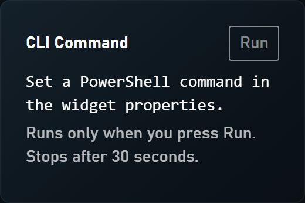

Run a configured PowerShell command and show its output and exit status. Select Run to start. Execution stops after 30 seconds.

- **Default size:** 360×220
- **Controls:** available on the desktop.

| key | type | default | options / range | description |
| --- | --- | --- | --- | --- |
| `label` | text | "CLI Command" |  | Header displayed above the output. |
| `command` | text | "" |  | Command or script to run when you press Run. Executes with your Windows user permissions. |

### Gauge — `gauge`

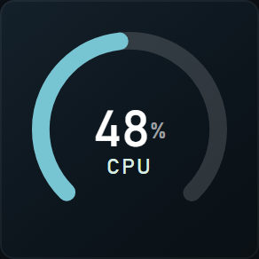

Show a numeric sensor as an arc, circle, bar, segmented gauge, or needle dial. The default range is 0–100%.

- **Data:** Numeric sensor. Default: `cpu.total`.
- **Default size:** 110×110

| key | type | default | options / range | description |
| --- | --- | --- | --- | --- |
| `label` | text | "CPU" |  | caption shown with the value |
| `unit` | text | "%" |  | suffix after the value, e.g. % or °C |
| `min` | number | 0 |  | value mapped to an empty gauge |
| `max` | number | 100 |  | value mapped to a full gauge |
| `value` | expr |  | → number | overrides the sensor, e.g. round(mem.used, 0) or cpu.total / 2 |
| `minExpr` | expr |  | → number (sets `min`) | a formula for the empty-gauge value (overrides min) |
| `maxExpr` | expr |  | → number (sets `max`) | a formula for the full-gauge value (overrides max) |
| `color` | color |  |  | fill colour of the arc (blank = theme accent) |
| `track` | color |  |  | colour of the unfilled arc |
| `style` | select | "arc" | `arc`, `circle`, `linear`, `pips`, `needle` | arc ring (default), closed circle, linear bar, discrete pips, or analog needle dial |
| `direction` | select | "arc" | `arc`, `ltr`, `rtl`, `btt`, `ttb` | pips + linear styles only: arc keeps pips on the ring; ltr/rtl/btt/ttb lay the bar or pip row along an axis |
| `pips` | number | 10 | min 3, max 40, step 1 | pips style only: number of segments |
| `sweep` | number | 270 | min 90, max 360, step 15 | arc/pips/needle styles: arc span in degrees (180 = semicircle); the gap stays centred at the bottom |

### Bar — `bar`

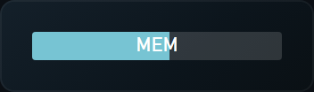

Show one numeric sensor as a horizontal or vertical bar.

- **Data:** Numeric sensor. Default: `mem.used`.
- **Default size:** 140×16

| key | type | default | options / range | description |
| --- | --- | --- | --- | --- |
| `label` | text | "MEM" |  | caption shown beside the bar |
| `min` | number | 0 |  | value mapped to an empty bar |
| `max` | number | 100 |  | value mapped to a full bar |
| `value` | expr |  | → number | overrides the sensor, e.g. clamp(cpu.total, 0, 100) |
| `minExpr` | expr |  | → number (sets `min`) | a formula for the empty-bar value (overrides min) |
| `maxExpr` | expr |  | → number (sets `max`) | a formula for the full-bar value (overrides max) |
| `orientation` | select |  | `horizontal`, `vertical` | fill direction |
| `color` | color |  |  | fill colour (blank = theme accent) |
| `track` | color |  |  | colour of the unfilled track |

### Sparkline — `sparkline`

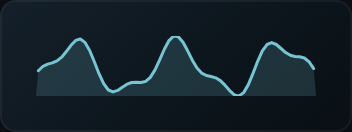

Show sensor history as a line, area chart, or histogram.

- **Data:** Sensor history. Default: `cpu.total`.
- **Default size:** 140×30

| key | type | default | options / range | description |
| --- | --- | --- | --- | --- |
| `smooth` | toggle | false |  | Play buffered recorded samples smoothly. Respects reduced motion; recorded values stay unchanged. |
| `smoothDelay` | number | 1.5 | min 1, max 10, step 0.5 | Playback delay for smooth charts. Buffers recorded samples so the right edge has known data. History duration stays unchanged. |
| `seconds` | number | 60 | min 5, step 5 | seconds of history to show |
| `color` | color |  |  | line / bar colour (blank = theme accent) |
| `fill` | toggle |  |  | fill the area under the line |
| `histogram` | toggle |  |  | draw bars instead of a line |
| `axis` | toggle | true |  | show a baseline axis line under the bars (histogram mode) |
| `barGap` | number | 0.2 | min 0, max 0.9, step 0.05 | gap between histogram bars, 0–0.9 of a slot (0 = touching) |
| `lineWidth` | number |  | min 0.5, step 0.5 | stroke thickness (line mode) |

### Text — `text`

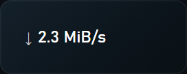

Show a formatted sensor value with an optional label and inline history sparkline. Formats include percentages, rates, bytes, durations, and integers.

- **Data:** Numeric sensor. Default: `net.down`.
- **Default size:** 100×18
- **Intrinsic size:** adjusts to the displayed content.

| key | type | default | options / range | description |
| --- | --- | --- | --- | --- |
| `label` | text | "↓" |  | prefix shown before the value |
| `format` | text | "rate" |  | percent \| rate (binary bytes/s) \| rate-short (one decimal / three significant figures, e.g. 1.2M/s) \| bytes \| duration \| integer; else raw |
| `value` | expr |  | → text | template: text + {expressions}, e.g. CPU {round(cpu.total)}% · {bytes(mem.used.bytes)} |
| `color` | color |  |  | text and inline graph colour (blank = theme) |
| `showSparkline` | toggle | false |  | Show the bound sensor history beside its current value. |
| `sparklineSeconds` | number | 60 | min 5, max 600 | History window for the inline graph, in seconds. |
| `sparklineWidth` | number | 40 | min 24, max 160, step 4 | Inline graph width in pixels. |
| `sparklineStretch` | toggle | false |  | Expand the inline graph to fill the space beside the value instead of using a fixed width. |
| `sparklineSmooth` | toggle | true |  | Scroll recorded samples left between readings. Enabled by default; respects reduced motion. |
| `sparklineDelay` | number | 1.5 | min 1, max 10, step 0.5 | Smooth playback delay. Buffers recorded data; does not shorten the selected history window. |
| `sparklineScale` | select | "auto" | `auto`, `percent` | Auto for rates and unbounded values; percent fixes the graph to 0–100 for percentage readings. |

### Clock — `clock`

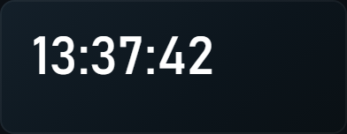

Show the date and time using a configurable format.

- **Default size:** 160×40
- **Intrinsic size:** adjusts to the displayed content.

| key | type | default | options / range | description |
| --- | --- | --- | --- | --- |
| `format` | text | "HH:mm:ss" |  | moment-style tokens: YYYY MMMM MMM MM M dddd ddd DD D HH H hh h mm m ss s A a; literals in [brackets], e.g. HH:mm:ss or dddd D MMMM |
| `locale` | select |  | `en`, `ja`, `zh` | month/day names |
| `label` | text |  |  | caption shown before the time |
| `color` | color |  |  | text colour (blank = theme) |

### Calendar — `calendar`

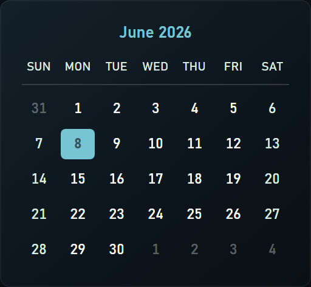

Show a month calendar and highlight today. Choose the first weekday and whether to show dates from the next month.

- **Default size:** 220×200

| key | type | default | options / range | description |
| --- | --- | --- | --- | --- |
| `firstDay` | select | "Sunday" | `Sunday`, `Monday`, `Tuesday`, `Wednesday`, `Thursday`, `Friday`, `Saturday` | which weekday starts each row |
| `locale` | select | "en" | `en`, `ja`, `zh` | weekday / month names |
| `weekdayHeader` | toggle | true |  | show the row of weekday names above the grid |
| `continuous` | toggle | false |  | spill dimmed days through the end of next month |
| `highlightToday` | toggle | true |  | mark the current day with the accent colour |
| `showTitle` | toggle | true |  | show the month + year heading |
| `color` | color |  |  | today highlight colour (blank = theme accent) |

### Analog Clock — `analogclock`

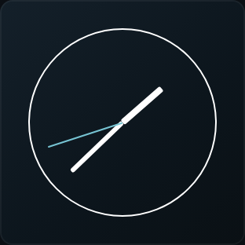

Show the time on an analog clock with hour, minute, and second hands.

- **Default size:** 120×120

| key | type | default | options / range | description |
| --- | --- | --- | --- | --- |
| `showSeconds` | toggle | true |  | show the sweeping second hand |
| `showTicks` | toggle | false |  | show minute / hour tick marks around the ring |
| `showNumbers` | toggle | false |  | show the 12 hour numerals |
| `showCap` | toggle | false |  | show a small disc where the hands meet |
| `color` | color |  |  | hour + minute hands, ticks, ring |
| `accent` | color |  |  | second hand colour |
| `face` | color |  |  | face fill (default transparent) |
| `lineWidth` | number | 0 | min 0, max 6, step 0.25 | ring and hand thickness in pixels; 0 scales with the dial size |
| `updateMs` | number | 1000 | min 16, step 50 | redraw interval; lower = smoother second hand, higher = lighter |

### Button / Macro — `button`

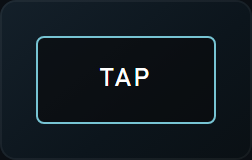

Run Home Assistant service calls or media controls when you select the button.

- **Default size:** 90×44
- **Controls:** available on the desktop.

| key | type | default | options / range | description |
| --- | --- | --- | --- | --- |
| `label` | text | "tap" |  | text on the button |
| `actions` | macro | [] |  | run these calls in order on press — domain/service like Home Assistant (put entity_id in data), or domain "media" for now-playing transport (playpause/next/previous) |

### CPU — `cpu`

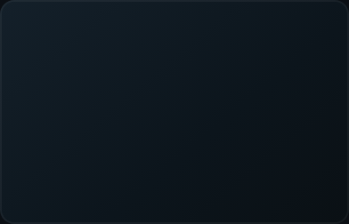

Show CPU usage as per-core charts or one combined gauge.

- **Default size:** 160×90

| key | type | default | options / range | description |
| --- | --- | --- | --- | --- |
| `smooth` | toggle | false |  | Play buffered per-core samples smoothly; respects reduced motion. |
| `smoothDelay` | number | 1.5 | min 1, max 10, step 0.5 | Playback delay for smooth charts. Buffers recorded samples so the right edge has known data. History duration stays unchanged. |
| `mode` | select | "cores" | `cores`, `combined` | per-core sparkline grid vs one combined gauge |
| `seconds` | number | 30 | min 5, step 5 | seconds of history to show |
| `label` | text |  |  | caption for the combined gauge |
| `cols` | number | 8 | min 1 | columns in the per-core grid (blank = 8; clamped to the core count) |
| `histogram` | toggle |  |  | draw bars instead of lines |
| `lineWidth` | number |  | min 0.5, step 0.5 | per-core stroke thickness |
| `color` | color |  |  | line / gauge colour (blank = theme accent) |

### Battery — `battery`

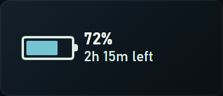

Show battery charge and charging status or remaining time. A computer without a battery shows “—”.

- **Default size:** 150×44

| key | type | default | options / range | description |
| --- | --- | --- | --- | --- |
| `showStatus` | toggle | true |  | show charging / time-remaining under the percent |
| `color` | color |  |  | battery icon fill (blank = theme accent) |

### GPU — `gpu`

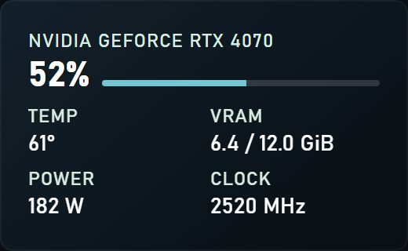

Show NVIDIA GPU usage and available temperature, memory, power, clock, and fan readings. Unavailable readings show “—”.

- **Default size:** 260×144

| key | type | default | options / range | description |
| --- | --- | --- | --- | --- |
| `label` | text |  |  | replace the detected card name |
| `showName` | toggle | true |  | show the GPU model header |
| `color` | color |  |  | utilisation colour (blank = theme accent) |

### Disks — `disks`

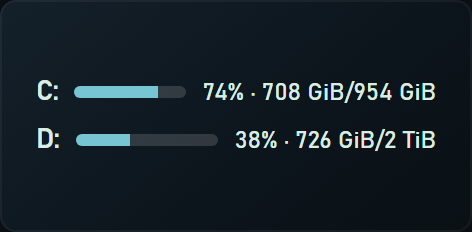

Show used space for each detected drive. Nearly full drives show a warning.

- **Default size:** 200×80

| key | type | default | options / range | description |
| --- | --- | --- | --- | --- |
| `showBytes` | toggle | true |  | append used/total bytes after the percent |
| `color` | color |  |  | usage bar colour (blank = theme accent) |

### Top Process — `topproc`

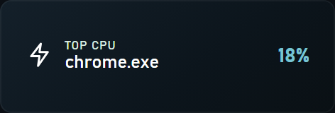

Show the process with the highest CPU, memory, disk activity, or GPU memory usage.

- **Default size:** 200×44

| key | type | default | options / range | description |
| --- | --- | --- | --- | --- |
| `by` | select | "cpu" | `cpu`, `mem`, `disk`, `gpu` | CPU %, RAM, disk I/O, or GPU VRAM (GPU needs NVIDIA/NVML) |
| `label` | text |  |  | header (defaults to "Top CPU" etc.) |
| `color` | color |  |  | value colour (blank = theme accent) |

### Process Watcher — `procwatch`

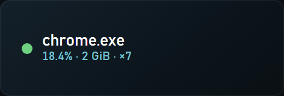

Show whether a named process is running. Combine CPU and memory usage across its instances.

- **Default size:** 200×44

| key | type | default | options / range | description |
| --- | --- | --- | --- | --- |
| `name` | text | "chrome.exe" |  | executable name, e.g. chrome.exe, obs64.exe, Spotify.exe |
| `label` | text |  |  | override the shown name (defaults to the process) |
| `color` | color |  |  | running-state colour (blank = theme accent) |

### Connections — `netconn`

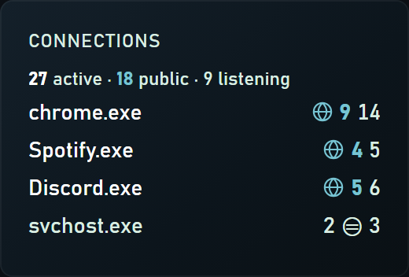

Show network connections by process. Include established connections, listening connections, and connections to public IP addresses.

- **Default size:** 240×150

| key | type | default | options / range | description |
| --- | --- | --- | --- | --- |
| `showListening` | toggle | false |  | include processes that are only LISTENing (accepting inbound), not just active talkers |
| `maxRows` | number | 8 | min 1, max 20, step 1 | how many processes to list (busiest — most public — first) |
| `color` | color |  |  | header / count colour (blank = theme accent) |

### Ping — `ping`

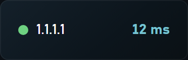

Check whether a host responds to ping and show its round-trip time. The default host is 1.1.1.1.

- **Default size:** 150×24
- **Intrinsic size:** adjusts to the displayed content.

| key | type | default | options / range | description |
| --- | --- | --- | --- | --- |
| `host` | text | "1.1.1.1" |  | IP or hostname to ping, e.g. 1.1.1.1 or cloudflare.com |
| `label` | text |  |  | override the shown name (defaults to the host) |
| `color` | color |  |  | up-state colour (blank = theme accent) |
| `slowMs` | number | 150 | min 1, step 10 | latency at/above this is shown as "slow" (amber) |

### Wi-Fi — `wifi`

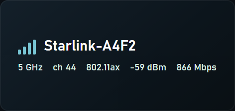

Show the Wi-Fi network name, signal strength, and connection details. The widget shows “Not connected” when Wi-Fi is disconnected.

- **Default size:** 200×76

| key | type | default | options / range | description |
| --- | --- | --- | --- | --- |
| `showDetail` | toggle | true |  | show band / channel / generation / RSSI / link rate under the SSID |
| `color` | color |  |  | signal bars colour (blank = theme accent) |

### Spectrum — `spectrum`

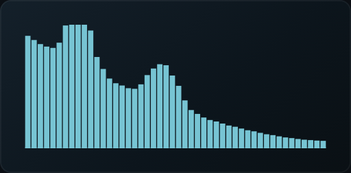

Show output audio as frequency bars or a scrolling spectrogram.

- **Default size:** 220×90

| key | type | default | options / range | description |
| --- | --- | --- | --- | --- |
| `device` | select | "" | (runtime list) — from `audioOutputs` | which audio output to visualise (blank = system default) — App-wide: one capture stream per app, so the last spectrum widget to (re)start sets the device for all spectrum widgets. |
| `scale` | select | "log" | `log`, `linear` | log spreads the low frequencies (musical, default); linear is even Hz/bar — App-wide like the device: shared by every spectrum widget. |
| `mode` | select | "bars" | `bars`, `spectrogram` | frequency bars vs a scrolling spectrogram heatmap |
| `pips` | toggle | false |  | gridline markers at 100 Hz / 1 kHz / 10 kHz |
| `bars` | number | 48 | min 8, max 128, step 1 | number of frequency bars (bars mode) |
| `gap` | number | 0.15 | min 0, max 0.9, step 0.05 | spacing between bars (0..1) |
| `color` | color |  |  | bars mode; defaults to the theme accent |

### Web Frame — `iframe`

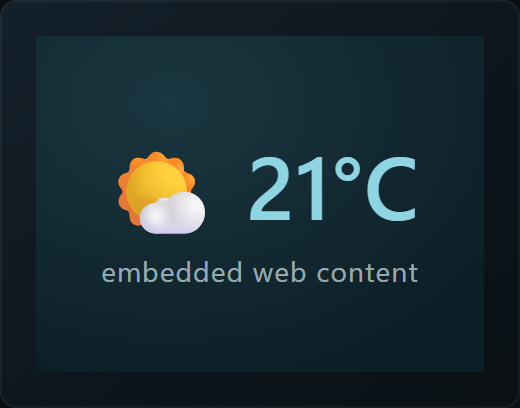

Show a web page in a frame. Enable interaction to use its controls.

- **Default size:** 320×240
- **Controls:** available on the desktop.

| key | type | default | options / range | description |
| --- | --- | --- | --- | --- |
| `url` | text | "" |  | bare domains get https://; only https:// loads (the CSP blocks plain http://); javascript:/data: are rejected |
| `title` | text | "" |  | accessible label for the frame (screen readers / tooltip) |
| `refresh` | number | 0 | min 0, max 3600, step 5 | auto-reload interval in seconds (0 = never); reloads cost CPU/network |
| `scroll` | toggle | false |  | allow scrolling inside the frame |
| `interact` | toggle | false |  | off: clicks pass through to the desktop; on: the frame catches clicks (passive overlay only — dragging always works in edit mode) |
| `sandbox` | toggle | true |  | recommended: isolates the page (scripts only, no parent/popups/top-nav) — Turn off only for a trusted page needing same-origin features (e.g. a Home Assistant login). |
| `referrerPolicy` | select | "no-referrer" | `no-referrer`, `origin`, `same-origin` | what Referer the embedded page sees (no-referrer leaks nothing) |
| `timeoutMs` | number | 6000 | min 1000, max 30000, step 500 | how long to wait for a load before showing a 'blocked or unreachable' hint |

### Zone — `zone`

Define an area for application windows. Hold Shift while dragging a window into it to snap. The zone is hidden on the overlay.

- **Default size:** 600×400

| key | type | default | options / range | description |
| --- | --- | --- | --- | --- |
| `matchExe` | text | "" |  | auto-arrange: snap a window of this exe here, e.g. Spotify.exe (blank = drag-only) |
| `matchClass` | text | "" |  | optional window-class glob refiner, e.g. Chrome_WidgetWin_1 |
| `matchTitle` | text | "" |  | optional title glob refiner, e.g. *Gmail* |

### Audio Switcher — `audioswitch`

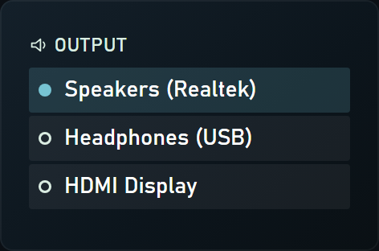

Select the default audio output device. The widget lists available devices and marks the active one.

- **Default size:** 200×120
- **Controls:** available on the desktop.

| key | type | default | options / range | description |
| --- | --- | --- | --- | --- |
| `color` | color |  |  | active-device colour (blank = theme accent) |

### Recycle Bin — `recyclebin`

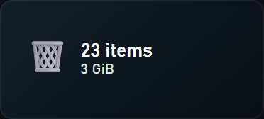

Show the Recycle Bin item count and size. Set a size threshold for a warning.

- **Default size:** 150×48

| key | type | default | options / range | description |
| --- | --- | --- | --- | --- |
| `color` | color |  |  | icon colour (blank = theme accent) |
| `warnGb` | number | 0 | min 0, step 1 | highlight when the bin reaches this many GB (0 = never) |

### Volume — `volume`

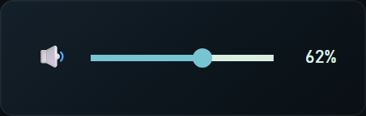

Adjust or mute the default audio output device.

- **Default size:** 190×36
- **Controls:** available on the desktop.

| key | type | default | options / range | description |
| --- | --- | --- | --- | --- |
| `color` | color |  |  | slider colour (blank = theme accent) |

### Image — `image`

Show an image from an HTTPS URL, data URL, or file in the wallpapers folder. Choose how it fits the widget.

- **Default size:** 200×150

| key | type | default | options / range | description |
| --- | --- | --- | --- | --- |
| `src` | text | "" |  | an image URL (https:// or data:), or a filename in your wallpapers folder |
| `alt` | text | "" |  | accessible description (screen readers) |
| `fit` | select | "contain" | `contain`, `cover`, `fill`, `none` | how the image fills the box (contain = whole image, cover = fill + crop) |

### Sticky Note — `note`

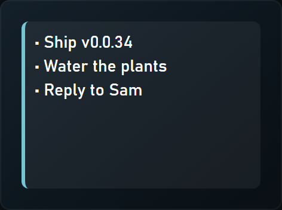

Enter a note on the overlay. The widget keeps the text across restarts.

- **Default size:** 200×140
- **Controls:** available on the desktop.

| key | type | default | options / range | description |
| --- | --- | --- | --- | --- |
| `placeholder` | text | "Notes…" |  | shown when the note is empty |
| `color` | color |  |  | the note’s left edge accent |

### Spacer — `spacer`

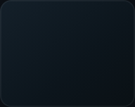

Reserve empty space between widgets. Studio shows an outline while editing.

- **Default size:** 60×40

_No configurable fields._

### Countdown — `countdown`

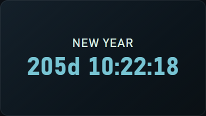

Count down to a date and time, or alternate Pomodoro work and break periods. Use Timer if you need start and pause controls.

- **Default size:** 170×80
- **Intrinsic size:** adjusts to the displayed content.

| key | type | default | options / range | description |
| --- | --- | --- | --- | --- |
| `mode` | select | "event" | `event`, `pomodoro` | count down to a date, or run a repeating work/break rhythm |
| `target` | text | "" |  | event mode: a date/time, e.g. 2026-12-31 or 2026-12-31T18:00 |
| `workMin` | number | 25 | min 1, step 1 | pomodoro work length |
| `breakMin` | number | 5 | min 1, step 1 | pomodoro break length |
| `label` | text | "" |  | caption above the remaining time |
| `format` | select | "auto" | `auto`, `dhms`, `hms`, `ms` | event display: auto trims units; dhms/hms/ms are fixed |
| `color` | color |  |  | text colour (blank = theme) |
| `countUp` | toggle | false |  | event mode: once the target passes, count the time elapsed since (instead of stopping at 0) |

### Timer — `timer`

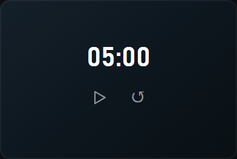

Use a countdown timer or stopwatch with start, pause, and reset controls. Drag the dial to set up to 60 minutes. Release to start.

- **Default size:** 160×96
- **Controls:** available on the desktop.

| key | type | default | options / range | description |
| --- | --- | --- | --- | --- |
| `mode` | select | "countdown" | `countdown`, `stopwatch` | count down from a duration, or up from zero |
| `duration` | number | 300 | min 0 | countdown length in seconds |
| `label` | text | "" |  | header text |
| `style` | select | "digital" | `digital`, `dial` | Dial: drag to set 0–60 minutes; release to start. Countdown only. Use a taller widget (about 220 × 280). |
| `format` | select | "auto" | `auto`, `mm:ss`, `hh:mm:ss`, `ss` | time display format |
| `color` | color | "" |  | text colour (blank = theme) |
| `loop` | toggle | false |  | restart automatically when a countdown reaches zero |

### Monitor Switch — `monitorswitch`

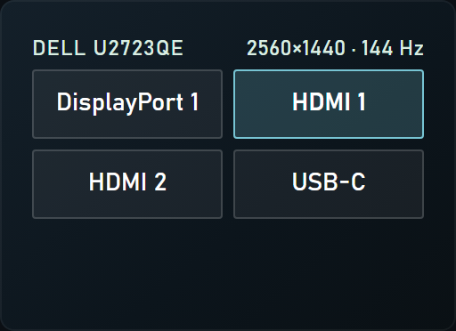

Switch monitor inputs and show the current source. Enable DDC/CI in the monitor settings. Available input codes depend on the monitor.

- **Default size:** 220×150
- **Controls:** available on the desktop.

| key | type | default | options / range | description |
| --- | --- | --- | --- | --- |
| `monitor` | select |  | (runtime list) — from `displayNames` | which monitor to control (blank = the primary monitor) |
| `sources` | monitorSources |  |  | pick which inputs to show and rename them (blank = show all detected) — Each source can also carry a volume (0–100, e.g. 0x12=NS2@20) applied when switching to it — only while "volume target" is not off. |
| `label` | text |  |  | title override (blank = the monitor’s name) |
| `showCurrent` | toggle | true |  | highlight the currently-selected input |
| `showStats` | toggle | false |  | show the current resolution + refresh rate |
| `compact` | toggle | false |  | show a compact list instead of large touch buttons |
| `color` | color |  |  | active-source colour (blank = theme accent) |
| `volumeTarget` | select | "off" | `off`, `system`, `monitor` | what a source’s paired volume changes when you switch (off = volumes are ignored) — The paired volume is the @NN in sources. system = the Windows master volume, set after the switch; monitor = the monitor’s own speakers over DDC/CI, set just before the switch. |
| `volumeDevice` | select |  | (runtime list) — from `audioOutputs` | which Windows output’s volume to set (blank = whatever is the default output at the time) |

### Status / Alerts — `alerts`

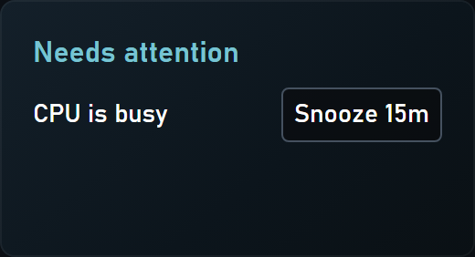

Show sensor threshold alerts only when attention is needed; snooze individual alerts.

- **Default size:** 320×150
- **Controls:** available on the desktop.

| key | type | default | options / range | description |
| --- | --- | --- | --- | --- |
| `label` | text | "Needs attention" |  | Heading above active alerts. |
| `rules` | text | "cpu.total\|above\|90\|CPU busy;mem.used\|above\|90\|Memory nearly full;disk.c.used.pct\|above\|90\|Disk C nearly full" |  | Separate rules with semicolons: sensor\|above/below\|threshold\|message. Thresholds are inclusive; missing readings do not alert. |
| `snoozeMin` | number | 15 | min 1, max 1440 | Hide an individual alert for this many minutes. |
| `meetingMinutes` | number | 10 | min 0, max 120 | Show upcoming timed events from the configured Agenda feed; 0 disables reminders. |

### Service Health — `servicehealth`

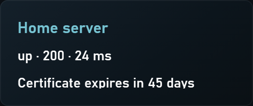

HTTP/HTTPS endpoint status, latency, and certificate expiry. Checks pause while hidden.

- **Default size:** 260×85

| key | type | default | options / range | description |
| --- | --- | --- | --- | --- |
| `label` | text | "Service health" |  | Name of the service being monitored. |
| `url` | text | "" |  | HTTP or HTTPS health endpoint. Tries HEAD, then GET if unsupported; reads headers only and reports redirects without following them. |
| `interval` | number | 60 | min 15, max 3600 | Seconds between checks; requests time out after 10 seconds. |
| `slowMs` | number | 1000 | min 1 | Mark responses at or above this latency as slow. |
| `warnDays` | number | 14 | min 0 | Warn when the HTTPS certificate expires within this many days. Unavailable for plain HTTP. |

### App Audio / Microphone — `audiomixer`

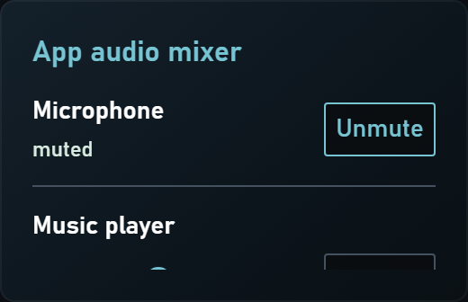

Independent app-session volume and mute, plus default communications microphone mute.

- **Default size:** 340×200
- **Controls:** available on the desktop.

| key | type | default | options / range | description |
| --- | --- | --- | --- | --- |
| `showMicrophone` | toggle | true |  | Show mute status and a toggle for the default communications microphone. |

### Task Checklist — `checklist`

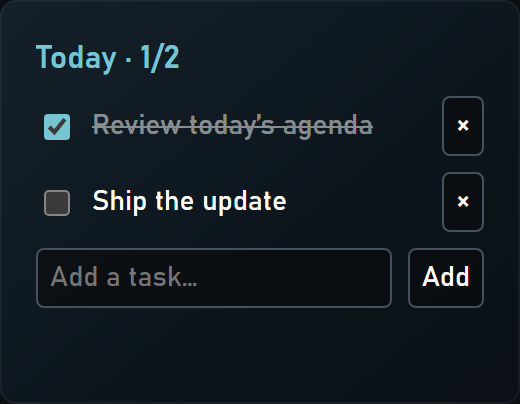

Persistent task list with checkboxes and add/remove controls; syncs across studio and overlay.

- **Default size:** 270×200
- **Controls:** available on the desktop.

| key | type | default | options / range | description |
| --- | --- | --- | --- | --- |
| `label` | text | "Today" |  | Heading above your tasks and completed count. |

### Sensor History — `history`

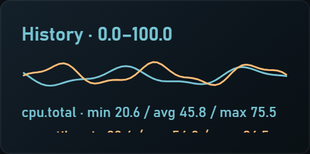

Compare sensor histories on one scale, with a threshold band and min/average/max summaries.

- **Default size:** 360×150

| key | type | default | options / range | description |
| --- | --- | --- | --- | --- |
| `label` | text | "History" |  | Heading above the comparison chart. |
| `sensorIds` | text | "cpu.total,gpu.util" |  | Comma-separated numeric sensor IDs. Compare sensors with the same units. |
| `seconds` | number | 60 | min 5, max 600 | Number of recent samples to display (roughly seconds for 1 Hz system sensors). |
| `fixedScale` | toggle | true |  | Pin the shared range instead of automatically scaling all lines together. |
| `smooth` | toggle | false |  | Blend chart changes between readings. Charts do not animate when reduced motion is on. Recorded values and summaries stay unchanged. |
| `min` | number | 0 |  | Bottom of the fixed chart scale. |
| `max` | number | 100 |  | Top of the fixed chart scale. |
| `showThreshold` | toggle | false |  | Shade the area at or above the threshold. |
| `threshold` | number | 80 |  | Beginning of the shaded warning band. |
| `showStats` | toggle | true |  | Show summaries of each visible history window in the legend. |

### AI Usage — `aiusage`

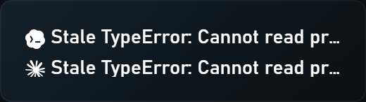

Claude and Codex quotas, token activity, credit balances and banked resets, with optional local history graphs and consumption estimates. Add OpenRouter, OMP or custom JSON commands.

- **Default size:** 265×44

| key | type | default | options / range | description |
| --- | --- | --- | --- | --- |
| `providerIcons` | toggle | true |  | Monochrome provider marks replace names in Compact and accompany names in Detailed. Choose each mark in the provider row. |
| `layout` | select | "compact" | `detailed`, `compact`, `minimal` | Detailed shows full readings; Compact wraps readings by provider; Minimal hides reading labels. Provider rows can override Detailed or Compact. |
| `minimalIcons` | toggle | false |  | Optional provider icons instead of hiding labels entirely. |
| `showHeader` | toggle | false |  | Optional heading above the provider rows. |
| `label` | text | "AI Usage" |  | Widget heading. |
| `providers` | usageProviders | [{"icon":"auto","settings":{"session":{},"week":{},"other":{},"tokens":{},"credits":{},"banked":{},"graph":{},"eta":{},"resets":{}},"labels":{},"order":["session","week","other","tokens","credits","banked","graph","eta","resets"],"id":"codex","source":"codex","label":"Codex","enabled":true,"command":"","env":"OPENROUTER_API_KEY","account":"","compact":"inherit","session":true,"week":true,"other":false,"tokens":false,"credits":false,"banked":true,"eta":false,"resets":false,"graph":false},{"icon":"auto","settings":{"session":{},"week":{},"other":{},"tokens":{},"credits":{},"banked":{},"graph":{},"eta":{},"resets":{}},"labels":{},"order":["session","week","other","tokens","credits","banked","graph","eta","resets"],"id":"claude","source":"claude","label":"Claude","enabled":true,"command":"","env":"OPENROUTER_API_KEY","account":"","compact":"inherit","session":true,"week":true,"other":false,"tokens":false,"credits":false,"banked":true,"eta":false,"resets":false,"graph":false}] |  | Codex and Claude are enabled initially. Add providers, override commands and choose visible readings independently. |
| `interval` | number | 900 | min 60, max 3600 | Backend requests are shared for 60 seconds across windows. Default: fifteen minutes. |
| `timeout` | number | 20 | min 5, max 60 | Maximum duration of each provider refresh. |

### Custom HTML — `customhtml`

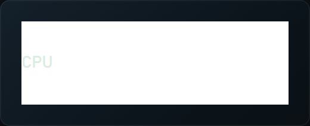

Build a portable isolated widget with HTML, CSS, JavaScript, theme tokens and selected sensors.

- **Default size:** 320×100
- **Controls:** available on the desktop.

| key | type | default | options / range | description |
| --- | --- | --- | --- | --- |
| `title` | text | "Custom HTML widget" |  | Accessible frame title. |
| `html` | text | "<main>CPU<strong id=\"value\">—</strong></main>" |  | Body markup, saved with the widget. Inline data images and SVG are supported. |
| `css` | text | "main { height: 100%; display: flex; align-items: center; gap: var(--np-row-gap); } span { color: var(--np-label); } strong { color: var(--np-fg); font-size: var(--np-text-heading); font-variant-numeric: tabular-nums; }" |  | Document styles. Use inherited --np-* theme tokens for a consistent look. |
| `javascript` | text | "widgetsack.subscribe(({ sensors }) => { const value = sensors['cpu.total']?.value; document.querySelector('#value').textContent = value?.kind === 'scalar' ? Math.round(value.value) + '%' : '—'; });" |  | Isolated module. Use widgetsack.subscribe(state => …) for selected sensors, theme tokens and viewport size. |
| `sensorIds` | text | "cpu.total" |  | Comma or newline separated sensor IDs; only these sensors are exposed (maximum 32). |
| `interact` | toggle | false |  | Catch mouse clicks in the overlay. Off passes clicks through to the desktop. |

### HA Sensor — `ha.sensor`

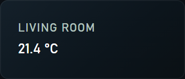

- **Data:** Structured sensor data.
- **Default size:** 150×44

| key | type | default | options / range | description |
| --- | --- | --- | --- | --- |
| `label` | text |  |  | caption (blank = the entity’s friendly name) |

### HA Binary Sensor — `ha.binary_sensor`

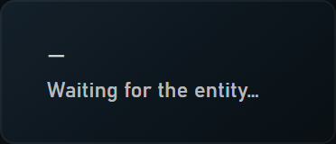

- **Data:** Structured sensor data.
- **Default size:** 150×44

| key | type | default | options / range | description |
| --- | --- | --- | --- | --- |
| `label` | text |  |  | caption (blank = the entity’s friendly name) |

### HA Light — `ha.light`

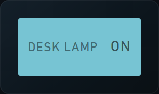

- **Data:** Structured sensor data.
- **Default size:** 120×56
- **Controls:** available on the desktop.

| key | type | default | options / range | description |
| --- | --- | --- | --- | --- |
| `label` | text |  |  | caption (blank = the entity’s friendly name) |
| `showBrightness` | toggle | true |  | show a brightness slider under the on/off toggle |

### HA Switch — `ha.switch`

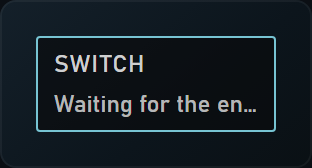

- **Data:** Structured sensor data.
- **Default size:** 120×48
- **Controls:** available on the desktop.

| key | type | default | options / range | description |
| --- | --- | --- | --- | --- |
| `label` | text |  |  | caption (blank = the entity’s friendly name) |

### HA Fan — `ha.fan`

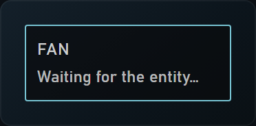

- **Data:** Structured sensor data.
- **Default size:** 150×56
- **Controls:** available on the desktop.

| key | type | default | options / range | description |
| --- | --- | --- | --- | --- |
| `label` | text |  |  | caption (blank = the entity’s friendly name) |
| `showSpeed` | toggle | true |  | show a fan-speed slider |
| `showOscillate` | toggle | true |  | show an oscillation on/off control |

### HA Climate / A-C — `ha.climate`

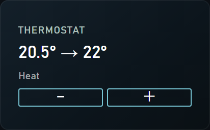

- **Data:** Structured sensor data.
- **Default size:** 170×92
- **Controls:** available on the desktop.

| key | type | default | options / range | description |
| --- | --- | --- | --- | --- |
| `label` | text |  |  | caption (blank = the entity’s friendly name) |
| `showMode` | toggle | true |  | show the HVAC mode control (heat / cool / off …) |
| `showTemp` | toggle | true |  | show the target-temperature − / + buttons |
| `showFan` | toggle | true |  | show the fan-mode picker |

### HA Cover — `ha.cover`

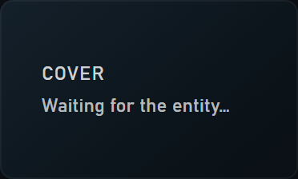

- **Data:** Structured sensor data.
- **Default size:** 150×76
- **Controls:** available on the desktop.

| key | type | default | options / range | description |
| --- | --- | --- | --- | --- |
| `label` | text |  |  | caption (blank = the entity’s friendly name) |
| `showButtons` | toggle | true |  | show open / stop / close buttons |
| `showPosition` | toggle | true |  | show a 0–100 % position slider |

### HA Lock — `ha.lock`

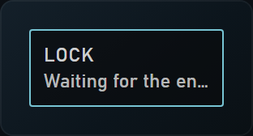

- **Data:** Structured sensor data.
- **Default size:** 120×48
- **Controls:** available on the desktop.

| key | type | default | options / range | description |
| --- | --- | --- | --- | --- |
| `label` | text |  |  | caption (blank = the entity’s friendly name) |

### HA Scene — `ha.scene`

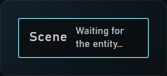

- **Data:** Structured sensor data.
- **Default size:** 130×40
- **Controls:** available on the desktop.

| key | type | default | options / range | description |
| --- | --- | --- | --- | --- |
| `label` | text |  |  | caption (blank = the entity’s friendly name) |

### HA Input — `ha.input`

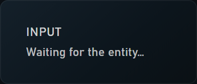

- **Data:** Structured sensor data.
- **Default size:** 160×48
- **Controls:** available on the desktop.

| key | type | default | options / range | description |
| --- | --- | --- | --- | --- |
| `label` | text |  |  | caption (blank = the entity’s friendly name) |

### HA Media Player — `ha.media_player`

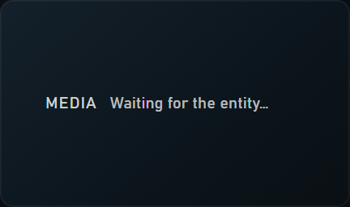

- **Data:** Structured sensor data.
- **Default size:** 240×120
- **Controls:** available on the desktop.

| key | type | default | options / range | description |
| --- | --- | --- | --- | --- |
| `label` | text |  |  | caption (blank = the entity’s friendly name) |
| `showTransport` | toggle | true |  | show previous / play-pause / next buttons |
| `showVolume` | toggle | true |  | show a volume slider |

### Now Playing — `nowplaying`

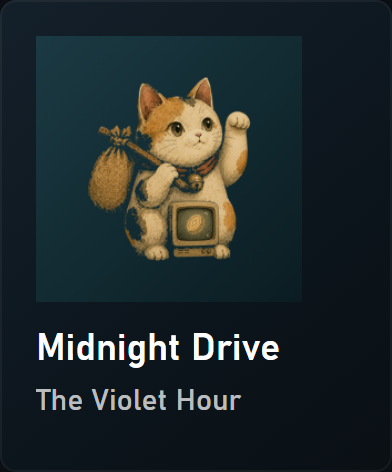

- **Default size:** 160×200
- **Controls:** available on the desktop.

| key | type | default | options / range | description |
| --- | --- | --- | --- | --- |
| `label` | text |  |  | text shown while nothing is playing |

### Stock Ticker — `ticker`

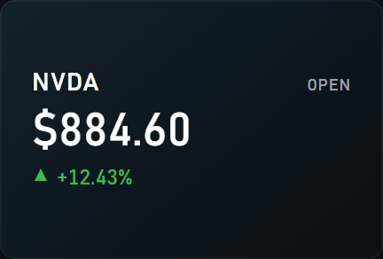

- **Default size:** 180×110

| key | type | default | options / range | description |
| --- | --- | --- | --- | --- |
| `symbol` | text | "NVDA" |  | e.g. AAPL, SPY, BTC-USD — must be in the Stocks plugin’s symbol list |
| `label` | text | "" |  | header text (defaults to the symbol) |
| `decimals` | number | 2 |  | price decimal places |
| `showSparkline` | toggle | true |  | show the intraday mini-chart |
| `invertColors` | toggle | false |  | red = up, green = down (East-Asian-market convention) |

### Weather — `weather`

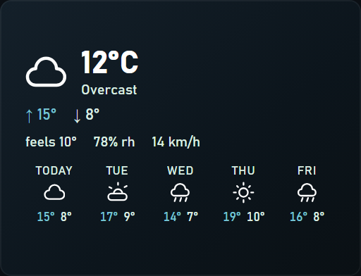

- **Default size:** 220×160

| key | type | default | options / range | description |
| --- | --- | --- | --- | --- |
| `showHiLo` | toggle | true |  | show today’s high / low beside the temperature (location is set in Plugins → Weather) |
| `showDetail` | toggle | true |  | show the feels-like temperature, humidity and wind line |
| `forecastDays` | number | 5 | min 0, max 7, step 1 | how many days of forecast to show below (0 = off; up to 7) |
| `color` | color |  |  | temperature / icon colour (blank = theme accent) |

### Sun & Moon — `sunmoon`

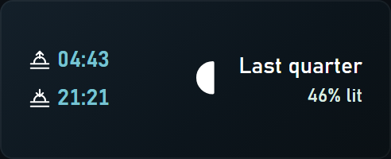

Show sunrise and sunset for the configured weather location. Show the current moon phase and illumination.

- **Default size:** 210×64

| key | type | default | options / range | description |
| --- | --- | --- | --- | --- |
| `showSun` | toggle | true |  | show today’s sunrise + sunset times (location is set in Plugins → Weather) |
| `showMoon` | toggle | true |  | show the current moon phase + illumination |
| `color` | color |  |  | sun / moon icon colour (blank = theme accent) |

### Air Quality — `airquality`

Show the European Air Quality Index, PM2.5, and UV index for the configured weather location.

- **Default size:** 190×86

| key | type | default | options / range | description |
| --- | --- | --- | --- | --- |
| `showPm` | toggle | true |  | show the PM2.5 reading (location is set in Plugins → Weather) |
| `showUv` | toggle | true |  | show the UV index |
| `color` | color |  |  | AQI band colour override (blank = colour-coded by band) |

### RSS — `rss`

Show headlines from the configured RSS or Atom feed.

- **Default size:** 260×150

| key | type | default | options / range | description |
| --- | --- | --- | --- | --- |
| `title` | text | "" |  | optional title above the list |
| `maxRows` | number | 8 | min 1, max 30, step 1 | how many headlines to show |
| `color` | color |  |  | header / bullet colour (blank = theme accent) |

### Agenda — `agenda`

Show upcoming events from the configured ICS calendar feed.

- **Default size:** 280×260
- **Controls:** available on the desktop.

| key | type | default | options / range | description |
| --- | --- | --- | --- | --- |
| `title` | text | "" |  | optional title above the list |
| `maxRows` | number | 6 | min 1, max 20, step 1 | how many upcoming events to show |
| `color` | color |  |  | time / timeline colour (blank = theme accent) |

### AI Chat — `aichat`

An interactive chat with your configured AI provider. Send messages, stop a reply, or clear the conversation. Chat is shared within each window.

- **Default size:** 360×300
- **Controls:** available on the desktop.

| key | type | default | options / range | description |
| --- | --- | --- | --- | --- |
| `label` | text | "AI Chat" |  | Header displayed above the conversation. |

### AI Prompt — `assistant`

Run a saved prompt with live sensor readings, manually or on an interval or cron schedule. Displays the latest response; use AI Chat for conversations.

- **Default size:** 280×96
- **Controls:** available on the desktop.

| key | type | default | options / range | description |
| --- | --- | --- | --- | --- |
| `prompt` | text | "Summarize my system status in one short, friendly sentence." |  | what to ask the AI (your live sensors are included automatically) |
| `schedule` | text | "10m" |  | Interval: 30s, 5m, 2h (15s minimum). Cron: minute hour day month weekday, e.g. 0 9 * * * for 09:00 local time. Blank or manual disables automatic runs. Runs while the overlay is open; Studio refreshes manually. |
| `sensors` | text | "auto" |  | comma-separated sensor ids to feed the prompt, or "auto" |
| `speak` | toggle | false |  | speak each update (TTS) |
| `label` | text | "AI Prompt" |  | header text |
| `color` | color | "" |  | text colour (blank = theme) |

### Transcribe / Translate — `transcribe`

Select the microphone to record speech. Select it again to stop and transcribe. Configure an OpenAI-compatible AI Provider. Translation and speech playback are optional.

- **Default size:** 320×120
- **Controls:** available on the desktop.

| key | type | default | options / range | description |
| --- | --- | --- | --- | --- |
| `mode` | select | "transcribe" | `transcribe`, `translate` | transcribe speech, or transcribe then translate. Click the mic to talk (push-to-talk — never always-listening). |
| `targetLang` | text | "English" |  | target language for translate mode (e.g. English, Spanish, 日本語) |
| `sourceLang` | text | "auto" |  | a hint for accuracy, or "auto" to detect (e.g. auto, en, ja, es) |
| `audioSource` | select | "" | (runtime list) — from `microphones` | which microphone to record from (blank = system default) |
| `model` | text | "" |  | blank = provider default (whisper-1); e.g. gpt-4o-transcribe, gpt-4o-mini-transcribe |
| `speak` | toggle | false |  | speak the result (TTS) |
| `label` | text | "" |  | header text |
| `color` | color | "" |  | text colour (blank = theme) |
